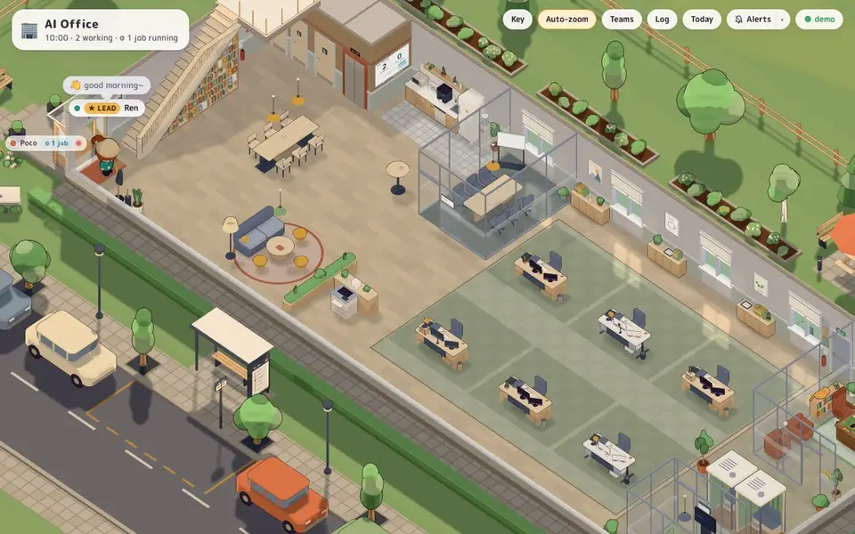
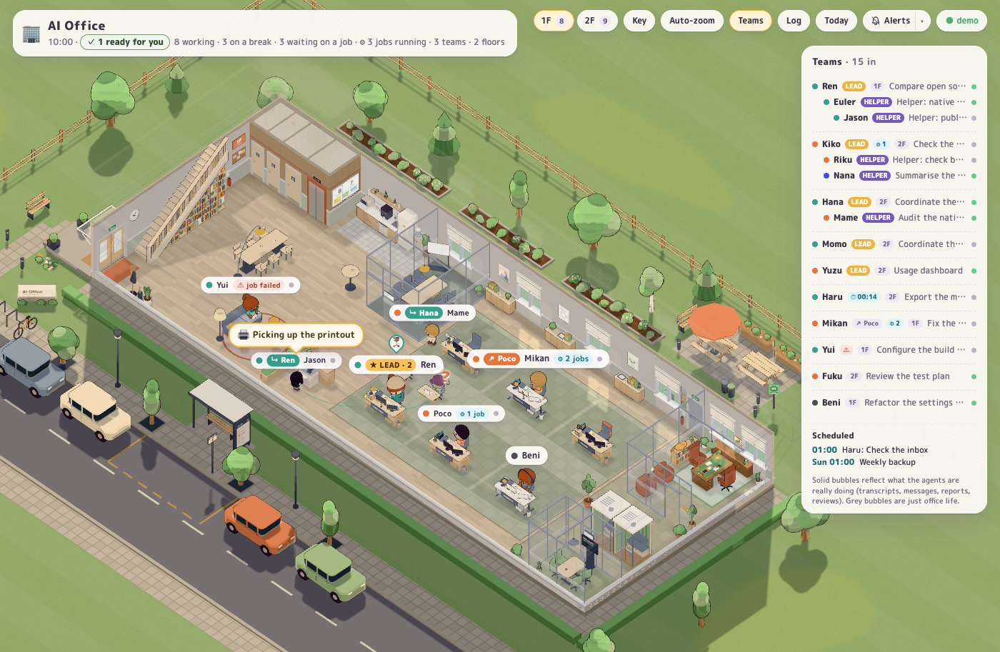

# AI Office

A cozy, fixed-camera 3D office where **every AI coding agent running on your machine is a chibi worker**, and agents
that work together sit together as a team.



Agents walk in through the door when a session starts, sit at a desk and type while they work, and show a brief
bubble with what is in their head. Each helper a lead spawns walks in, gets briefed at the side of the lead's desk and
takes a desk in the lead's pod. Helpers report back in person when they finish, reviewers stamp a verdict in the review
room, and everyone stretches, grabs a coffee and hangs around the lounge for a while when their work is done, then
leaves.

It is a real monitor, not a toy: the office only shows agents that actually exist right now, and the hierarchy and
interactions come from the agents' own logs.



## Try it

You need [Node](https://nodejs.org) 22.13 or newer (it uses the built-in `node:sqlite`). The only dependencies are
`three` and `ws`.

```bash
npm install
npm start
```

Then open <http://localhost:4477>. If you have no agent running, the office is empty: <http://localhost:4477/?demo>
plays a scripted team instead.

Used day to day on macOS. On Linux the tests pass and the server starts and serves the page, checked on every push,
but it has not been watched with real agents there. Windows is not supported (it reads the process table with `ps`).
Keeping it running at login is macOS only (a LaunchAgent).

## Privacy

Everything stays on your machine. The office reads your agents' local logs and databases and never writes to them. It
keeps its own records in `data/` (gitignored), which holds your tasks and project names. The server listens only on
this machine and refuses requests from other web sites, so a page you happen to have open cannot read your agents. The
page fetches nothing from outside; even its font ships with the project.

## Settings

Set these in the environment before `npm start`:

| Variable | What it does | Default |
| --- | --- | --- |
| `AI_OFFICE_PORT` | the port | `4477` |
| `AI_OFFICE_LAT`, `AI_OFFICE_LON` | where the sun is worked out for, in degrees (set both) | Hong Kong |
| `AI_OFFICE_DATA_DIR` | where the office keeps its own records | `data/` here |
| `AI_OFFICE_TIME_ZONE` | the zone the day log rolls over in | your system's |
| `AI_OFFICE_LINKS_DIR`, `AI_OFFICE_JOBS_DIR` | where other tools report links and jobs | `~/.ai-office/links`, `~/.ai-office/jobs` |

## Page options

`?demo` plays a scripted office with a full team scenario, `?demo=deleg` only the work-handed-over scene (a chat whose
tool starts a worker), `?demo&crowd=24` fills several floors to stress-test (`&reviewers` gives every lead a reviewer: a full review room), `?hour=22`
previews any hour (`&date=2026-06-21` any day; `&windows=tall|wide|round|walls` tries other windows), `?timelapse` plays a whole day of light in a minute in that tab (`?timelapse=30` in 30 s, from 05:00 or from `?hour`, on `?date`), `?zoom=3&focus=x,z` magnifies a spot, `?soak` runs the built-in anomaly monitor (a badge in the
corner; `?soak&report` or a click on it shows the log; it survives reloads for two hours), `?perf` shows a frame-time
readout (median, 1% low, draw calls) and posts it to the server once a minute (`GET /api/perf` reads the last 60, in
memory only). Click a name tag for details; the **Teams** pill
toggles the roster panel.

**Which agents:** Claude Code (desktop and CLI, with Agent-tool helpers), Codex (desktop and CLI, with spawned agents and
Guardian reviewers), Cursor (agent chats from its local state database, with explore subagents) and Gemini CLI (local
logs / chat recordings). Copilot leaves no local session trace on a Mac, so it is not shown. Any other tool can report jobs and links by writing the open formats below.

**As an app:** Chrome "Install as app" or Safari "Add to Dock" on <http://localhost:4477> gives the office its own
window and icon; the dock badge and the tab title show how many agents are waiting on you. The **Alerts** pill turns
on desktop notifications when an agent starts waiting on you (off by default; optional soft chime in its ▾ menu).

**One office, any number of tabs:** the office runs on the server whether or not a page is open. The director
(`web/director.js`) decides who sits where and who goes where, and saves that to `data/director.json` (local, gitignored),
so a restart reshuffles nobody. A page only draws it: open one and people are already at their places, mid-walk if they
were walking, and only a session that really just started walks in. Every tab shows the same people in the same places
doing the same things; the floor you look at, the camera and your panels are your own, and so are small gestures like
blinks and glances.

**The day:** every real state change and event is appended to `data/journal/YYYY-MM-DD.jsonl` (local, gitignored).
A whiteboard on every floor (on the lift/WC core, beside the kitchenette) shows today's honest numbers and the latest
finished work; the office log survives reloads. `GET /api/today` and `GET /api/journal?since=<ms>` serve the same data,
and `npm run validate` replays a journal and flags flicker, suspicious "waiting on you" episodes, orphan helpers and
double counts.

**Keep it running at login** (macOS LaunchAgent, restarts on crash, logs to `~/Library/Logs/ai-office.log`):

```bash
npm run install-service
```

`npm run uninstall-service` stops it again (the plist goes to the Trash). `npm run open` opens the office in your
browser; for a window of its own, Chrome/Edge "Install as app" or Safari "Add to Dock" on <http://localhost:4477>
works well.

**On screen:** the camera keeps its fixed angle but auto-frames the people who are in (toggle with the
**Auto-zoom** pill or by double-clicking the scene); click a team in the **Teams** roster to look at that pod for a
moment. While the roster runs down the right-hand side, the frame makes room for it. The **Log** pill opens the office log: arrivals, departures, delegations, messages, reports, verdicts and
finishes, newest first, real events only. In a busy spot, name tags declutter: people in front keep the full tag,
the others shrink to name + role and stack upward on a thin leader (hover a tag for the full text); someone simply
sitting and working yields first and shrinks to a coloured dot, so asks, errors and finished work keep their tags. The **Key** pill
explains the tags and bubbles. When an agent is waiting on you, the header shows a dark **🙋 waiting on you** button
(click it to jump to them, on whichever floor) and that floor's pill carries a 🙋 badge.

## What is real and what is ambient

**Real (solid bubbles, the amber ones are interactions):**

| Behaviour | Data behind it |
| --- | --- |
| Someone walks in / leaves | a Claude Code session registered in `~/.claude/sessions`, a transcript being written, a Codex thread updated recently, a Cursor agent chat in its state database, or Gemini CLI logs / chat recordings |
| Typing / thinking / talking at the desk | last entry in the transcript or rollout: tool call, thinking block / reasoning summary, assistant text |
| Thought bubble text | that same entry (tool described in words, text snippet, reasoning summary) |
| Lead role | the agent has (or had) helpers: Claude `Agent` tool subagents, Codex `spawn_agent` threads |
| Helper joins the lead's pod, gets briefed | child transcript / thread appears with the parent link (Codex `parent_thread_id` + nickname, Claude `subagents/agent-*.jsonl`) |
| "Calling for help: …", "Briefing …" | Codex `spawn_agent` task name / Claude Agent description |
| "To X" / "From Y" messages | Codex inter-agent messages (`agent_message`, `send_message`, `followup_task`); bodies are encrypted, so only sender and recipient are shown |
| Helper prints the report, collects it at the print island and hands it to the lead | Codex `task_complete.last_agent_message` / the Claude subagent's `SubagentHandback` message (snippet shown) |
| 🙋 Hand up, desk flag, call-light blink, dark question bubble, "waiting on you" in the header | the agent is blocked on you: an open `AskUserQuestion` / `ExitPlanMode` call, an open tool call while the session itself has been idle for a few seconds (a permission prompt), Codex `request_user_input`, or a Codex escalated command waiting for your approval (only when you review approvals yourself; with auto review, Guardian decides) |
| Lead crossing arms, "Waiting for …" | Codex `wait_agent`, a Claude `Agent`/`Task`/`TaskOutput` call still open, or a Claude lead whose turn is over while its helpers still work |
| Reviewer collects the work at the lead's desk, reviews it in the review room, stamps ✅ / ⚠️ there and walks the verdict back | Codex Guardian review thread and its JSON verdict (`outcome`, `risklevel` / `risk_level`) |
| 💦 mark | a Claude tool result that is an error, or a failed Codex command ("Script failed" / non-zero exit code) |
| Coffee break, then leaving | the session has been idle (no new activity / task complete) for a while |

**Needs you, at a glance (real):** an agent blocked on you stands up beside its desk, turns to face you and waves,
on a soft amber pool of light, with the question in a dark bubble (header: 🙋 N waiting on you). A session that just
finished hands back a sheet toward you, stays at its desk for a couple of minutes glancing over at you, and leaves a
white flag with a sage ✓ on its desk until it works again; its name tag carries a "✓ your turn" chip (header: ✓ N ready
for you). Ready and waiting states only switch after holding for 8 s, so they don't flicker. Thin dashed threads on the floor link a lead to its helpers; dots flow while a helper works and the thread
pulses when its report lands; open someone's card or hover their tag and their team's threads stand out. In a crowd,
helpers in a lead's pod wear a small "↳ Lead" chip in the lead's colour and the lead's chip counts them
("★ LEAD · 3"). Zoomed out, only questions, errors and real events keep a bubble (routine thoughts drop out; hover a
tag to read them) and a tag rings briefly when something new happens to that worker. Repeated errors make someone slump and toss a crumpled page into the bin.

**Desks and rooms carry status physically:**

| What you see | Real data behind it |
| --- | --- |
| Light strip on the back of a monitor: steady brand colour / slow pulse / amber / red blink / dim / grey | working / thinking / waiting on helpers / tool error in the last 8 s / idle at the desk / away on a break |
| Paper stack beside the monitor grows | how long the session has been running |
| Crumpled paper in and around the desk bin | one per tool error the session hit |
| Jacket over the chair, screen locked | owner is on a break but still in the office (the desk is cleared when they leave) |
| Pod sign on the desk's front panel | the team's real project |
| Helper chairs in the team area's colour | a lead with helpers (each of a floor's six team areas has its own colour) |
| An open laptop on the desk, the chair turned toward it | a background job or a timer still going after the turn ended |
| Printouts in the lead's slate in-tray | one per real report a helper handed in |
| Meeting-room whiteboard and door sign (Free / In use · project) | a kickoff: the real helper names and tasks |
| Review desk trays | reviews in progress on this floor / verdicts stamped on this floor |
| Desk lamp on at night | someone is working at that desk; empty desks stay dark |
| Facade windows lit at night, bay by bay | an occupied desk within about 4 m of that window |
| The lamp over the meeting table, huddle table or café table, or the lounge's floor lamp, on at night | a kickoff is running there / someone is sitting there |
| Soft glow from the screen on the desk and sitter at night | someone at that desk, brighter while really working |
| A chair left pushed back and turned in a meeting room | someone got up from it after a real kickoff; the next person to sit in it pulls it in |
| Chair tucked in | nobody owns the desk right now |

Every person's look comes from their id: one of ten hairstyles, a natural hair colour (a rare pastel dye), one of six
skin tones, a slightly different height and build, and for about half of them an accessory (glasses, cap, beanie,
headphones, scarf, a flower or clip). The vendor colour stays on the shirt, so the brand still reads at a glance.

Each agent also gets one personal desk item (photo, cactus, headphones, books, small figurine …) chosen from its id, so the
same agent keeps the same desk character.

**Kickoffs:** when a lead spawns helpers (a real event) and the meeting room on its floor is free, the lead walks into
the room, the new helpers join at the table (late joiners too), there is a short kickoff, then everyone takes their desk.
Further spawns by the same lead within a minute get the quick desk-side briefing instead. The meeting room is staging;
the delegation it shows is real.

**Seasons (by the real local date):** pumpkins and a pennant garland at the porch for Halloween (Oct 20 – Nov 1), a
tree, string lights and door wreaths for the winter holidays (Dec), red lanterns, couplets and a mandarin tree around
Lunar New Year, paper lanterns for Mid-Autumn; they glow at night. `?season=halloween|winter|lunar|midautumn|none`
previews one.

**Ambient (grey dashed bubbles, never agent communication):** coffee (people queue behind the machine), a chat at the
standing table, reading in the 2F reading lounge, slouching on bean bags, foosball for two in the 3F game corner,
a short trip to the restroom, small talk at the lounge (symbols only),
watering plants, looking out of the window, yawns, humming, the cat. Which quirks a character has (coffee lover,
fidgety, sleepy, cheerful, sociable, plant person) is derived from its id so the same session always behaves the same.

**The building and its life (staging, but physical):** the office sits on a site with a lawn, a street, a path up
two steps to a glass porch, a sign, a bench and trees that sway in the breeze. People arrive along the path, the door
swings open before they reach it and springs shut behind them, and they wipe their feet on the mat. At night the
office is lit from inside (warm light from the ceiling that the cutaway removes, desk lamps only where someone works, the porch and street lamp on).
Everyone stands on a soft contact shadow, and anyone walking behind tall furniture shows as a faint silhouette in
their agent colour. The coffee machine steams while someone brews and the water cooler bubbles when used (ambient).
Each person has their own pace and thinking pose (chin on hand, hand to head, leaning back and looking up), rolls
their shoulders now and then, carries their mug back, and leads glance over at their team.

## Linking your own tool

Anything that makes agents talk to each other outside the vendors' own files (a coordination tool, a task queue, a
shared mailbox, your own script) can tell the office about it by appending one JSON line per message to
`~/.ai-office/links/<tool>.jsonl` (or `$AI_OFFICE_LINKS_DIR`):

```json
{"v":1,"id":"mytool:run-42:brief","at":"2026-10-26T06:12:16Z","kind":"brief","from":"codex:<thread-id>","to":"claude:<session-id>","text":"Audit the native auth route","channel":"mytool"}
```

A `brief` makes the receiver a helper in the sender's team while both are present; a `reply` is the report walk;
`message`, `review`, `verdict`, `handoff` and `approval` are the other kinds. The format, the party refs (`claude:`,
`codex:`, `cursor:`, `gemini:`, `pid:`, `name:` for a stub), append-only and rotation rules, confidence levels, privacy
and a ten-line adapter are in **`LINKS.md`**. `AGENT_COMMUNICATION.md` is the design behind it. The office itself
carries no adapter for any particular tool: a tool that wants to be seen writes the format.

Without any links file the office still notices one common case on its own: an agent whose process was started from
inside another vendor's app (for example a Codex chat whose tool runs `claude -p`). When exactly one top-level agent of
that vendor is at work in the same project, that agent is taken to be the one who gave the work (an *inferred* link, so
the office says "probably"). The worker then sits at the free desk nearest its giver with a work order in the giver's
colour on its desk front (dog-eared when inferred), takes the work as a phone call, raises its hand **toward the giver**
("Probably needs Sora's OK: …", not counted as waiting on you), and hands back as "✓ probably Sora's turn" before
leaving on the helper timer. An ask that stays open 3 minutes, or one made while the giver is itself waiting on you,
becomes yours. Hover either name tag to see the line between them.

## Office rules (server/config.js)

- **working** → at the desk; **idle** → stretch, coffee, lounge; idle for `leaveAfterIdleMs` (6 min) → walks out.
  Helpers and reviewers leave after 90 s idle (helpers say goodbye to their lead first), and so does a worker another
  agent gave its work to (it has handed back). An ask to that agent stays its own while it works; it becomes yours once that agent has stopped for
  `askEscalateMs` (3 min) without answering.
- busy again while on a break → walks back to the desk; after leaving → walks back in through the door.
- A floor has a fixed plan, zoned by noise and privacy from the entrance inward, as real offices are: the entrance with
  the staircase right beside the door (people bound for another floor never cross the room); the social band with the
  pantry along the back wall and the lounge at the front (a sofa lounge on the ground floor, a reading lounge on 2F, a
  game corner on 3F, repeating upward); the shared rooms (glass meeting room, print island) as a
  buffer; the open work area with 6 team pods on one rectangular carpet; and the quiet corner at the far end with the
  review room against the back wall (a glass sign-off office: a partners' desk for 2, two club armchairs, the office
  library; more reviewers wait by its door), a glazed huddle room for 2–4 (a kickoff with one or two new helpers meets
  there, bigger crews use the meeting room) and two focus pods (furniture only: every piece agents use stands for a real
  status, and a long think or command is still the same work, so it stays at the desk). A low planter trough separates the lounge from the print island, and the floor number hangs on the
  stairwell wall. Every floor also has a core along the back of the entrance band (two WCs, an accessible WC and the
  lift, sized for a floor of 30; breaks use whichever WC is free), a small lobby with a work café table where coffee
  breaks sit, a kitchenette (sink, fridge, microwave, coffee), a fire exit at the end of the aisle beside the review
  room (on upper floors it opens onto a steel balcony along the back to outdoor fire stairs down the side facade), and the
  ground floor a double entrance door. When a floor is
  full the next agent goes upstairs; floors are removed again when they empty. The **1F / 2F …** pills (only existing
  floors are listed; arrow keys also work) switch the view. The floor directly above is drawn as a faint ghost of its
  architecture only (no furniture, no people), floors below are dimmed (their people drawn as frozen snapshots),
  higher floors are hidden. Floors below the one you look at get their full facade back, so the stack reads as a
  building (with warm windows at night where people are). Each floor has its own accent colour (core, lift surround,
  floor sign) and every pod sits on its own team rug.
- The stairwell is a scissor stack against the left wall (20 steps of 18 cm per floor, a solid spine balustrade between
  the lanes): flights alternate between two lanes and all rise toward the back, so each flight sits beside the opening
  for the one below. Walls rise to the underside of the slab above;
  people step up tread by tread. While the floor above is unused, a faint plate marks where the flight arrives.
- Work that goes on after a turn is shown too: a worker waiting on a background job or a timer rests at their desk with the chair turned to an open laptop, instead of going to the lounge, and does not leave while it runs. Schedules are listed in the Teams panel and on the day board. Any tool can report jobs: see "Jobs from any tool" in AGENT_COMMUNICATION.md.
- A chat started by another chat shows it: a `↗ Name` chip on its tag, a desk nearby when one is free, and a line on hover. Two chats merely in the same folder are not linked.
- The sun is the real sun over the place you set (Hong Kong unless you set `AI_OFFICE_LAT` and `AI_OFFICE_LON`): it moves with the time and the season, and sunrise, sunset and the lamps follow it. After sunset the garden falls slowly through a blue hour while the lamps take over the room. Light
  gets into the building only through its openings, so window-shaped patches cross the floor through the day (the window wall faces
  south, so around midsummer, when the sun stays on the north side of the sky, none comes in at all). One list of openings (`web/openings.js`) cuts the walls and what stops the sun, so
  a different window needs no change to the lighting. The wall clock is real too. Outside: a street with lamps and a zebra
  crossing, a lit monument sign and bollards along the path, a fenced garden, and a staff terrace (picnic tables, a
  bench, bins, planters, assembly point, lit bollards and a wall light over the door) that the fire exit leads to; at
  night the windows spill light onto the lawn.

## Art direction

The room uses one restrained palette (`PAL` in `web/office.js`): cream walls, light oak, one slate upholstery, with sage,
terracotta and mustard as the only accents. Brand colours (Claude orange, Codex teal, helper lavender, reviewer blue)
are reserved for people, screens and UI so the agents always read first. Exceptions are physical standards only: the red
extinguisher, the green exit sign, hot/cold taps. `scripts/lint-chained-add.sh` guards against `parent.add(x).rotation…`,
which transforms the parent (it once tilted the whole building).

## Checks and performance

- **Today** (top right) opens a timeline of the day from the journal: one bar per agent (working in its colour, on a
  break in pale grey, waiting on you in ink with a mustard edge), report / verdict / spawn markers, hover for times,
  click a row to jump to that agent. Helpers sit under their lead; more than four fold into one lane (click to unfold).
- The Today drawer has a **Week** tab: seven days with an hourly heat strip (working minutes), sessions, helpers,
  hours working, waiting on you and reports; click a past day for its read-only timeline. APIs: `/api/week?end=`,
  `/api/journal?day=YYYY-MM-DD` (strictly validated), alongside `/api/today` and `/api/journal?since=`.
- **Office sounds** (opt-in, in the Alerts ▾ menu, off by default): synthesized in the browser, no audio files — a door
  chime when someone arrives, soft typing that follows how many work on the floor you're looking at, a gentle bell
  when someone needs you (skipped when the Alerts chime already rings), a ding when someone finishes, a paper rustle
  for a helper's report. Rate-limited, quiet, and muted while the tab is hidden.
- The header fits any width: less used pills (Key, Auto-zoom, Teams, Log) fold into a "⋯" menu, floor buttons turn
  compact, and on a phone the status card sits above one row of pills; panels keep clear of it.
- **Worker card** (click anyone, or Tab / Shift+Tab through the people on the floor; Esc closes): a strip of their day,
  first seen and time worked today, their last five real actions with times, their team (click to jump), time in
  the office and the project.
- `npm test` runs the week-digest, collector, links, delegation, midnight-rollover, director, sun, openings, jobs, request-origin and HUD-fit tests.
- `npm run smoke` starts the real server with an empty home folder and checks that it comes up, serves the page and refuses other web sites.
- `npm run synccheck` (Chrome installed) runs the crowd demo from a server, opens two tabs 90 s apart and compares them
  every 15 s: seat, floor, activity and position. It exits 1, naming the differences, if they disagree; `-- --live` compares
  two tabs on the running office instead. `scripts/crowdserver.mjs` is that crowd on its own, for any number of tabs.
- `npm run roomcheck` (server running, Chrome installed) plays the crowd demo headless for 8 minutes and fails, naming
  it, if any shared room or spot is never used: coffee, café, lounge, WC, huddle and meeting room.
- `npm run lint` runs the static checks: no chained transforms on `.add()`, no statements swallowed by a trailing
  comment, and `node --check` on every web/ and server/ module.
- `__office.check()` in the browser console reports whether every floor and desk group is untransformed (no stray
  rotation or scale), plus fps, draw calls and triangles.
- Static scenery is batched (`web/merge.js`): once a floor is built, everything that never moves is merged into one
  mesh per material family, with plain colours baked into vertex colours. Chairs, lead kits, the cat and each
  character's limbs are batched as rigid parts. **Anything that moves, toggles visibility, scales or is rebuilt
  must sit under an object flagged `userData.dynamic`**, or it will be frozen in place. Desk props (paper stack,
  crumples, report pile, personal item, jacket, pod sign) and helper desks are merged again after each change. People
  on the floors you are not looking at are drawn as one merged snapshot of their pose (an impostor), rebuilt when they
  sit, stand or change what they hold. A full crowd (4 floors, about 50 people) at night runs at about 75 fps on the
  ground floor and about 70 fps on an upper floor (the old, shorter plan ran at 42 fps before batching). Interior
  night lights are switched off entirely by day.
- `AGENT_COMMUNICATION.md` is the design for detecting communication between agents across vendors and
  coordination layers from first principles (links, identity, confidence, what is drawn); `LINKS.md` is the open
  format any tool can write.

## Layout

```
server/            Node: collectors → snapshot (agents, teams, events) → WebSocket (+ static files)
  index.js               HTTP + WebSocket entry, static files, journal APIs
  origin.js              who may talk to the server (this machine's own page and tools, not other web sites)
  config.js              office rules (timers, thresholds, time zone, journal folder)
  tail.js                reads the end of a log file; maps worktrees back to their repo
  collectors/claude.js   Claude Code registry, transcripts, Agent-tool subagents
  collectors/codex.js    Codex SQLite threads + rollouts (messages, reports, verdicts)
  collectors/cursor.js   Cursor agent chats (read-only state database + agent transcripts)
  collectors/gemini.js   Gemini CLI logs and chat recordings
  journal.js             day journal (data/journal), /api/today, /api/journal
  links/                 link readers: declared (the open format in LINKS.md, from ~/.ai-office/links), process ancestry; the resolver
  jobbook.js, rrule.js, jobdrop.js   background jobs, timers and schedules from any tool (~/.ai-office/jobs)
  startedby.js           which chat started which
  model.js               lifecycle, roles, team resolution, event dedupe, idle tracking
  probe.js               `node --no-warnings server/probe.js` prints who is in and recent events
web/               Browser: Three.js scene
  office.js        one floor: zones (entrance, social, shared rooms, work, quiet), pods, kitchenette, lift/WC core, meeting room, day board, stairs, facade; obstacle footprints
  timeline.js      the Today drawer (journal → one bar per agent, folding, tooltips, jump-to)
  dayboard.js      the day board on every floor (today's finished work from the journal)
  jobs.js, jobprops.js   what a job means for its worker; the desk laptop and kitchen timer that show it
  threads.js       team threads on the floor between a lead and its helpers
  site.js          the grounds: lawn, street, path and steps, porch, sign, bench, street lamp, mixed trees, shrub beds, parked cars, bus shelter
  merge.js         static batching (per floor and per rigid part)
  toon.js          shared toon materials and ink outlines
  ghost.js         semi-transparent rendering for floors above the active one
  nav.js           navigation grid: footprints inflated by the character radius, A*, line-of-sight smoothing
  character.js     procedural chibi (role outfits: tie & badge, hoodie, blazer) + animations
  director.js      runs the office, no 3D: who sits where, who goes where and since when, as spot ids and wall-clock times
                   (the server runs it for the live office, a tab only for `?demo`)
  agents.js        floors, stair routing and climbing; draws the director's plan: a step becomes a walk and a pose, plus gestures and bubbles
  bubbles.js       HTML name tags with role chips, thought / event / ambient bubbles, emotion marks
  sun.js           the sun's position from date and place, and the look of the light at each height (no 3D)
  openings.js      the list of openings: walls cut from it, the shell that stops the sun made from it
  lightshader.js   light in every lit material's shader: indoors only, sky through each opening, sun bounced off the ground
  main.js          camera, lights, daylight, night lights, HUD, roster, WebSocket client, `__office` debug handle
  seasons.js       seasonal decorations by the real date
  sound.js         opt-in office sounds (WebAudio, synthesized)
  hudfit.js        the header fit plan (which pills fold), a pure function
  palette.js       vendor and role colours, names, the look of each person (hash of the id)
  index.html, style.css  the page, HUD, panels, drawer and card
  demo.js          the `?demo` team scenario and the `?demo&crowd=N` stress test (with idle spells and late kickoffs,
                   so every room gets used)
  perf.js          the `?perf` frame-time readout
  fonts/           M PLUS Rounded 1c (SIL Open Font License), the pieces a page loads as its text needs them
  app/             installable web app: manifest, icons (make-icons.mjs), opt-in alerts (notify.js)
scripts/           smoke.mjs, lint-chained-add.sh, lint-comment-swallow.sh, test-hudfit.mjs, validate-journal.mjs
                   (`npm run validate`), roomcheck.mjs (`npm run roomcheck`), install/uninstall the LaunchAgent
test/              one file per area; `npm test` runs them all
docs/              the README's clip and screenshot
LINKS.md           the open link format (v1): one JSON line per message, for any tool
AGENT_COMMUNICATION.md  the design: links, identity, confidence, what is drawn, plugin readers, open questions
```

## Not affiliated

An independent project, not made or endorsed by Anthropic, OpenAI, Anysphere or Google. Their product names are used
only to say which tools the office can read.

## License

MIT, see [LICENSE](LICENSE). The office runs on [three.js](https://threejs.org) and [ws](https://github.com/websockets/ws), both also MIT, and its font, M PLUS Rounded 1c, is under the SIL Open Font License (`web/fonts/LICENSE-OFL.txt`).
